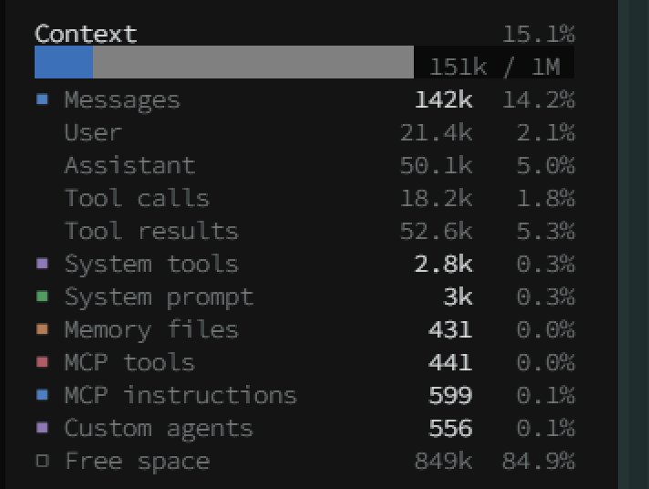

# opencode-context-panel

A [Claude Code](https://claude.com/claude-code)-style **Context** panel for the OpenCode CLI sidebar:
where the context window actually goes, broken down by category.

<!-- Drop a screenshot at docs/screenshot.png and uncomment the line below. -->
<!--  -->

```
Context                      23.5%
██████████░░░░░░░░░   235k / 1M
■ Messages           228k    22.8%
  User                 3k     0.3%
  Assistant           18k     1.8%
  Tool calls          28k     2.8%
  Tool results       178k    17.8%
■ System tools       2.6k     0.3%
■ System prompt      2.7k     0.3%
■ Memory files        397     0.0%
■ MCP tools           406     0.0%
■ MCP instructions    444     0.0%
■ Custom agents       513     0.1%
□ Free space         765k    76.5%
```

## What is exact and what is estimated

This matters, so it is stated up front.

**Exact** — taken from the provider's own usage report for the last response:

- `235k / 1M`, the `23.5%` in the header, and `Free space` (`limit - used`);
- which text belongs to which category: the panel inspects the *actual* request
  OpenCode sends to the model (system prompt, tool definitions, transcript), it does
  not guess.

**Estimated** — only the character→token conversion used to split the total across
rows. Category sizes are measured in characters, then rescaled so that their sum
matches the exact prompt size. So the total is right, and the *ratios* between rows
are as measured; an individual row is typically within ~10–15% (JSON tool schemas
tokenize a bit denser than prose).

In short: use it to see **what to prune**, not to audit tokens to the last digit.

## How it works

A plugin package with two halves that talk over a documented RPC:

| file | runs on | does |
|---|---|---|
| `src/index.ts` | the OpenCode server | hooks `session.hook("context")`, sees the assembled request, stores one snapshot per session |
| `src/categories.ts` | — | pure logic: marker parsing and the breakdown |
| `src/rpc.ts` | — | the shared RPC contract (`context-panel.breakdown`) |
| `src/tui.tsx` | the CLI | renders the panel into the `sidebar.content` slot |

Categories are recognised by the markers OpenCode itself uses when assembling the
prompt: `Instructions from: …` (memory files), `<available_skills>`,
`<mcp_instructions>`, and `Available subagents:` (custom agents). MCP tools are
matched by their server name prefix. If a marker ever changes, that row simply
disappears — nothing breaks.

## Install

Requires OpenCode 2.0.x (built and tested against 2.0.32).

### From npm

```sh
npm install -g opencode-context-panel
```

Then reference it in your OpenCode config (`~/.config/opencode/opencode.json`):

```json
{
  "plugins": ["opencode-context-panel"]
}
```

### Manually, into the plugin directory

OpenCode also discovers plugin folders under `<config>/plugins/<name>/`. Copy the
sources there — **without** `package.json`, otherwise the folder is treated as an
npm package:

```sh
mkdir -p ~/.config/opencode/plugins/context-panel
cp src/index.ts src/categories.ts src/rpc.ts src/tui.tsx ~/.config/opencode/plugins/context-panel/
```

```powershell
$dst = "$env:USERPROFILE\.config\opencode\plugins\context-panel"
New-Item -ItemType Directory -Force $dst | Out-Null
Copy-Item src\*.ts, src\*.tsx $dst
```

### For development

Point the plugin folder at this checkout's `src` so edits are picked up live:

```powershell
$dst = "$env:USERPROFILE\.config\opencode\plugins\context-panel"
Remove-Item -Recurse -Force $dst -ErrorAction SilentlyContinue
New-Item -ItemType Junction -Path $dst -Target "$PWD\src"
```

Restart the CLI (`opencode`) after installing — TUI plugins are loaded at startup.
The panel appears at the top of the sidebar; the sidebar must be open.

## Notes and limitations

- The server half only runs when a model request is made, so a session that has not
  sent anything yet shows `waiting for first request`.
- Snapshots are kept per location: a session in another project asks its own server
  instance, which is why the panel is addressed by session **and** location.
- The last 200 sessions are kept in memory; nothing is written to disk.
- Message sub-rows (`User` / `Assistant` / `Tool calls` / `Tool results` /
  `System notes`) come from the same transcript the model receives, split by part type.
- `System notes` covers system-role messages injected mid-conversation (for example
  MCP instruction updates).

## License

MIT
